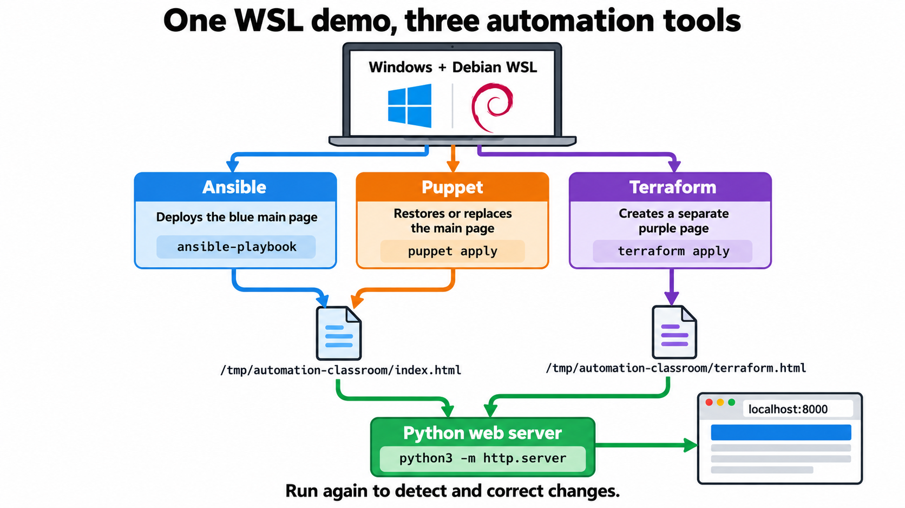

# Classroom automation demo

A small website makes configuration management visible. Ansible deploys a blue page; Puppet deploys an orange page. Both manage the same file, so students can see each tool restore its desired state after a manual change.



## Setup on Debian in WSL 2

From Windows PowerShell, open the Debian WSL distribution:

```powershell
wsl -d Debian
```

If that name is not recognized, run `wsl --list --quiet` in PowerShell to see your installed distribution names, then use the listed name with `wsl -d`.

Once you are at the Debian shell prompt, install the tools:

```bash
sudo apt update
sudo apt install -y ansible puppet-agent python3
```

Open this folder in your Debian shell. For example, a folder at `C:\Users\Administrator\Documents\ChatGPT\wsl-demo` appears at `/mnt/c/Users/Administrator/Documents/ChatGPT/wsl-demo`.

## Run the demo

In terminal 1, from this folder, deploy the first page:

```bash
sudo ansible-playbook -i localhost, -c local ansible-demo.yml
```

In terminal 2, start the web server:

```bash
python3 -m http.server 8000 --directory /tmp/automation-classroom
```

Open <http://localhost:8000> in your Windows browser. Refresh after each step.

If the server reports `Address already in use`, port 8000 is occupied. An earlier copy of the demo server may already be running; try <http://localhost:8000> first. Otherwise start this server on another port and open the matching URL:

```bash
python3 -m http.server 8001 --directory /tmp/automation-classroom
```

Open <http://localhost:8001>. To see what is listening on port 8000, run `sudo ss -ltnp '( sport = :8000 )'`.

Run Ansible a second time. Its output should show `changed=0`.

Now replace the managed page with a manual change:

```bash
echo 'Someone changed the site!' | sudo tee /tmp/automation-classroom/index.html
```

Refresh the browser, then rerun the Ansible command. The blue page returns.

Next, apply the Puppet manifest:

```bash
sudo puppet apply puppet-demo.pp
```

Refresh to see the orange page. Run Puppet again to show that it makes no further change. Then repeat the manual edit and rerun Puppet to restore its page.

Finally, run Ansible once more. The page changes back to blue because the two examples specify different desired content for the same file.

## what to look for 

- **Desired state:** each file says what the website should look like.
- **Idempotence:** rerunning a tool makes no change once the page matches.
- **Drift correction:** a manual edit is replaced on the next run.
- **Typical deployment:** Ansible runs from a controller and commonly connects to other machines over SSH. Puppet commonly uses an agent on each managed machine. This demo keeps both local to avoid network setup.

This uses Python's small built-in web server to display the result. No web server configuration or Puppet server is needed.

## Optional Terraform extension

This version uses the same Python web server. Terraform creates its own purple page at `/terraform.html`, while Ansible and Puppet continue to manage `/index.html`. It is a small exercise in Terraform's plan, apply, state, and drift workflow. Terraform is usually used for infrastructure such as VMs and cloud resources; the local file keeps this class exercise simple.

Install Terraform inside the Debian WSL shell using [HashiCorp's Debian package repository](https://developer.hashicorp.com/terraform/install):

```bash
sudo apt update
sudo apt install -y gnupg wget lsb-release
wget -O - https://apt.releases.hashicorp.com/gpg | sudo gpg --dearmor -o /usr/share/keyrings/hashicorp-archive-keyring.gpg
echo "deb [arch=$(dpkg --print-architecture) signed-by=/usr/share/keyrings/hashicorp-archive-keyring.gpg] https://apt.releases.hashicorp.com $(lsb_release -cs) main" | sudo tee /etc/apt/sources.list.d/hashicorp.list
sudo apt update
sudo apt install -y terraform
terraform version
```

Run the Ansible playbook once, then give your Debian user permission to add a second file to the demo directory:

```bash
sudo ansible-playbook -i localhost, -c local ansible-demo.yml
sudo chown "$USER" /tmp/automation-classroom
```

Keep the Python server running. From this project's folder in Debian:

```bash
cd terraform
terraform init
terraform plan
terraform apply
```

Type `yes` when Terraform asks. Open <http://localhost:8000/terraform.html>, or use port 8001 if that is where you started the Python server. The main page also links to the Terraform page.

Run `terraform plan` again to show no changes. Then try changing the class name:

```bash
terraform apply -var='class_name=Year 10 IT'
```

Refresh the Terraform page to see the new heading. You can also replace `/tmp/automation-classroom/terraform.html` manually and rerun the same `terraform apply -var=...` command to show Terraform restoring it.

At the end, run `terraform destroy` from the `terraform` folder. It removes only the Terraform page; the Ansible and Puppet page remains.
